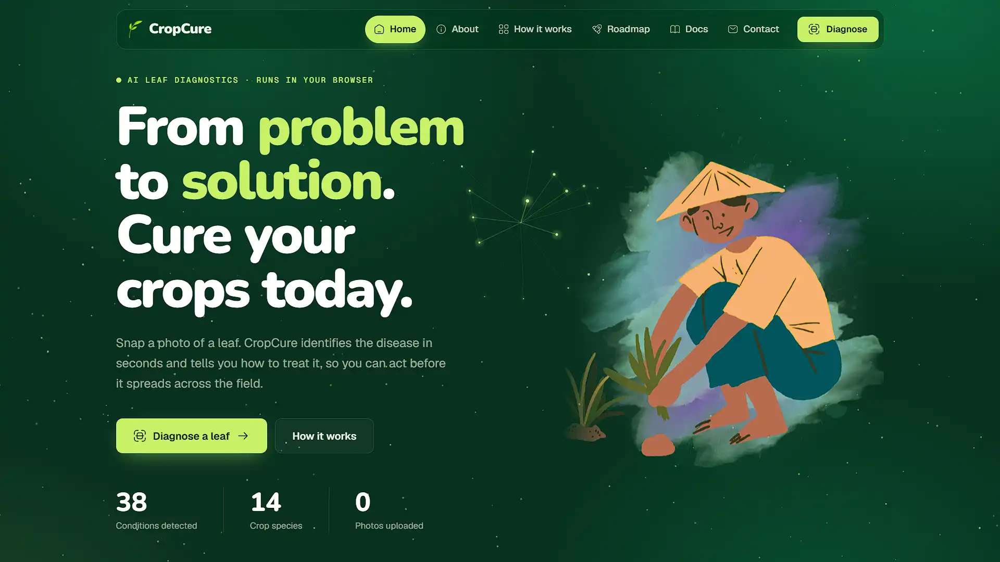

# CropCure 🌱

**AI plant disease detection and treatment, right in your browser.**

**[Live site](https://mycropcure.vercel.app)** · **[Diagnose a leaf](https://mycropcure.vercel.app/model/)** · **[Model docs](https://mycropcure.vercel.app/docs/)**

[](https://mycropcure.vercel.app)

Snap a photo of a leaf and CropCure identifies the disease in seconds, then recommends how to treat it, so you can act before it spreads across the field. The deep-learning model runs entirely on your device with TensorFlow.js: no sign-up, nothing to install, and your photos never leave your browser.

---

## Features

- **Instant diagnosis** of **38 conditions across 14 crops**: apple, blueberry, cherry, corn, grape, orange, peach, bell pepper, potato, raspberry, soybean, squash, strawberry and tomato
- **Treatment recommendations** for every detected condition
- **Confidence score** plus the next most likely conditions
- **Sample leaves** so you can try the model without uploading anything
- **Drag & drop** or browse to upload your own photo
- **Remembers your progress**: your image and result are still there if you leave the page and come back
- **Private by design**: inference happens 100% client-side; nothing is uploaded to a server
- **Model documentation** covering supported crops, the network architecture, the inference pipeline, the dataset and treatment sources
- **Fast first run**: the home page quietly pre-downloads the model in the background, so the diagnosis tool is ready almost instantly

## Tech stack

| Area | Tools |
| --- | --- |
| Front end | Plain HTML, CSS and vanilla JavaScript (no build step) |
| Machine learning | [TensorFlow.js](https://www.tensorflow.org/js) 4.22 graph model (CNN, 256×256 RGB input, 38-class softmax) |
| Smooth scrolling | [Lenis](https://github.com/darkroomengineering/lenis) |
| Fonts | Nunito, Geist and Geist Mono via Google Fonts |
| Icons | [Reicon](https://reicon.dev) and [Font Awesome Free](https://fontawesome.com) |
| Media | AV1 / VP9 WebM video and WebP images |
| Hosting | [Vercel](https://vercel.com) (static) |

## Project structure

```
CropCure/
├── index.html          # Landing page
├── style.css           # Shared design system (all pages)
├── app.js              # Shared interactions: smooth scroll, nav, animations, particles, model preloading
├── sw.js               # Service worker that caches the model for repeat visits
├── vercel.json         # Cache headers for the model and media
├── Images/             # Illustrations, logo, icon sprite, looping video, favicons
│   ├── meta/           # Social preview images (Open Graph / Twitter cards)
│   └── teamicons/      # Team photos
├── docs/
│   ├── index.html      # Model documentation
│   ├── docs.css        # Docs-specific styles
│   └── docs.js         # Renders the crops, conditions and architecture data
└── model/
    ├── index.html      # Diagnosis tool
    ├── styles.css      # Tool-specific styles
    ├── script.js       # Model loading, prediction, results, saved progress
    ├── treatments.js   # Treatment plans, action steps and products for all 38 classes
    ├── demo/           # Sample leaf photos
    └── tfjs_model/     # TensorFlow.js model (model.json + 31 weight shards, ~124 MB)
```

## Run locally

The diagnosis tool loads its model with `fetch`, so the site must be served over HTTP. Opening `index.html` directly from disk won't work.

```bash
# from the project folder
python -m http.server 8000
```

Then open:

- Landing page: <http://localhost:8000/>
- Diagnosis tool: <http://localhost:8000/model/>
- Model docs: <http://localhost:8000/docs/>

Any static file server works (for example `npx serve`).

## Deploy

CropCure is a static site, so deploy the **whole repository** (the diagnosis tool uses shared files from the root).

**Vercel:** import the repository, choose the *Other* framework preset, and leave the build command and output directory empty. `vercel.json` adds cache headers so returning visitors don't download the model again.

The live version is at **<https://mycropcure.vercel.app>**. It also works on GitHub Pages, Netlify or any static host.

## How the model works

1. The image is resized to **256 × 256** and passed to the model as raw RGB values (0–255).
2. The model outputs a probability for each of the 38 classes.
3. The top class is shown as crop + condition, with its confidence and a matching treatment.

The model was trained on the [PlantVillage dataset on Kaggle](https://www.kaggle.com/datasets/mohitsingh1804/plantvillage), and the class labels follow it. The full details are in the [model docs](https://mycropcure.vercel.app/docs/).

> ⚠️ **Disclaimer:** CropCure's recommendations are general guidance, not professional agronomic advice. Check with your local agricultural extension service before applying any treatment.

## Roadmap

- Built-in AI advisor for up-to-date treatment advice
- 7-day local weather forecasts
- Climate-based crop suggestions
- Smart irrigation scheduling
- In-app treatment store
- Android app

## Team

CropCure was built by a team of three.

| Member | Role | What they did | Links |
| --- | --- | --- | --- |
| **Yash Chaurasia** | ML & Full-Stack Engineer | Tuned the trained model, researched and integrated the treatment plans for every condition, and designed and built the website and working prototype | [LinkedIn](https://www.linkedin.com/in/yashchaurasia01/) · [Portfolio](https://yashexe.vercel.app) |
| **Aashman Singh Verma** | ML Engineer | Found and prepared the PlantVillage dataset and trained the disease-classification model | [LinkedIn](https://www.linkedin.com/in/asv11/) · [Portfolio](https://not-aashman.github.io) |
| **Parth Nagar** | ML Engineer | Found and prepared the PlantVillage dataset and trained the disease-classification model | [LinkedIn](https://www.linkedin.com/in/parth-nagar-430161273/) · [Portfolio](https://parth-portfolio-gules.vercel.app) |

See the [team section of the docs](https://mycropcure.vercel.app/docs/#team) for the full who-did-what breakdown.

## Credits & licenses

- **Training data:** [PlantVillage dataset on Kaggle](https://www.kaggle.com/datasets/mohitsingh1804/plantvillage)

- **Sample leaf photos:** [PlantVillage dataset](https://github.com/spMohanty/PlantVillage-Dataset), licensed [CC BY-SA 3.0](https://creativecommons.org/licenses/by-sa/3.0/)
- **UI icons:** [Reicon](https://reicon.dev), MIT License
- **Social icons:** [Font Awesome Free](https://fontawesome.com/license/free), CC BY 4.0
- **Smooth scrolling:** [Lenis](https://github.com/darkroomengineering/lenis), MIT License
- **ML runtime:** [TensorFlow.js](https://github.com/tensorflow/tfjs), Apache 2.0

## Contact

Website and prototype by **Yash Chaurasia**. For questions, feedback or partnerships:

- Email: [xukyosho@gmail.com](mailto:xukyosho@gmail.com)
- Portfolio: [yashexe.vercel.app](https://yashexe.vercel.app)
- LinkedIn: [yashchaurasia01](https://www.linkedin.com/in/yashchaurasia01/)
- GitHub: [YashChaurasia01](https://github.com/YashChaurasia01)
- Instagram: [@yashc.exe](https://www.instagram.com/yashc.exe/)
